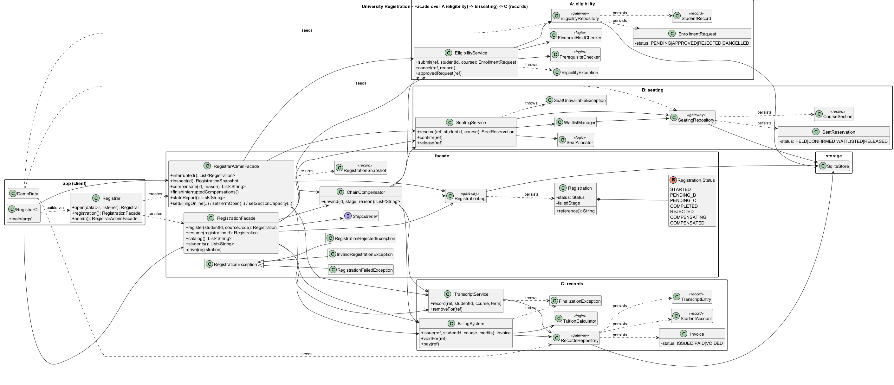

# University Registration — Facade Pattern

Assignment 4, variant 7: **University Registration**.

The client does one thing: *register a student for a course*. Behind it, three independent subsystems work in a chain:

```
A  eligibility  ->  B  seating  ->  C  records
   can the          is there a      issue the invoice and
   student join?    free seat?      add the course to the transcript
```

If B or C fails, the facade undoes the steps that already succeeded.



The diagram is also available as [SVG](docs/uml/class-diagram.svg) and [PlantUML source](docs/uml/class-diagram.puml).

---

## How to run

You need **JDK 17 or newer**. Maven is not needed; the Maven Wrapper (`mvnw`) downloads it.

| Action | Command (Windows) |
|---|---|
| Run the app | `mvnw.cmd -q compile exec:java` |
| Run with a clean database | `mvnw.cmd -q compile exec:java -Dexec.args="--reset"` |
| Run the tests | `mvnw.cmd test` |
| Tests + coverage check (80 %) | `mvnw.cmd verify` |

On Linux or macOS use `./mvnw` instead of `mvnw.cmd`.

- **Data** is stored in the `data/` folder as four SQLite files.
- **To reset it**, run with `--reset` or delete `data/`; demo data is created again on the next start.
- **Coverage report:** `target/site/jacoco/index.html`.

---

## The three subsystems

| | Package | Main classes | Entity and statuses |
|---|---|---|---|
| **A** | `eligibility` | `EligibilityService`, `PrerequisiteChecker`, `FinancialHoldChecker`, `EligibilityRepository` | `EnrollmentRequest`: PENDING, APPROVED, REJECTED, CANCELLED |
| **B** | `seating` | `SeatingService`, `SeatAllocator`, `WaitlistManager`, `SeatingRepository` | `SeatReservation`: HELD, CONFIRMED, WAITLISTED, RELEASED |
| **C** | `records` | `BillingSystem`, `TranscriptService`, `TuitionCalculator`, `RecordsRepository` | `Invoice`: ISSUED, PAID, VOIDED |

What each subsystem has:
- **Own database file** (`eligibility.db`, `seating.db`, `records.db`), used only through its own repository.
- **A business-logic class**: `PrerequisiteChecker`, `SeatAllocator`, `TuitionCalculator`.
- **Its own transition rules**: each entity checks which status changes are allowed (`canMoveTo`).
- **No dependency on the other two**: the subsystems only meet inside the facade.

Each subsystem also works on its own, without the facade: see `StandaloneDemo` and the `*StandaloneTest` classes.

---

## The two facades

- **`RegistrationFacade`** — for students:
  - `register(student, course)` runs A → B → C;
  - `resume(id)` continues a chain that was interrupted by a crash.
- **`RegistrarAdminFacade`** — for the registrar:
  - view what is stored;
  - undo (compensate) a registration by hand;
  - finish interrupted compensations;
  - turn failures on and off for the demo.

The progress of every chain is saved in `registrations.db`:

```
STARTED -> PENDING_B -> PENDING_C -> COMPLETED
       \-> REJECTED                     (A said no, nothing to undo)
PENDING_B / PENDING_C -> COMPENSATING -> COMPENSATED
```

---

## How the undo (compensation) works

Every subsystem stores the registration number (`REG-5`) next to its own data. When something fails, `ChainCompensator`:

1. saves the status `COMPENSATING`;
2. asks each subsystem what it **really has on disk** for `REG-5`, starting from the end: C, then B, then A;
3. undoes only what exists;
4. saves the status `COMPENSATED`.

| What failed | Example | What is undone |
|---|---|---|
| **B fails after A** | the section is full | A: the request is cancelled |
| **C fails after A and B** | the invoice is over the student's credit limit | B: the seat is released, then A: the request is cancelled |
| C fails after its own invoice | the transcript term is locked | C: the invoice is voided, then B, then A |
| A says no | financial hold, missing prerequisite | nothing (nothing was saved downstream) |
| invalid input | unknown student or course | nothing (nothing was saved at all) |

Because the facade reads the real state from disk, it works after a restart too. If the app is killed in the middle
of a chain, the next start finds the unfinished registration and can either continue it or undo it.

Custom exceptions:
- **Subsystems:** `EligibilityException`, `SeatUnavailableException`, `FinalizationException`.
- **Facade:** `InvalidRegistrationException`, `RegistrationRejectedException`, `RegistrationFailedException`.

---

## Demo app

Demo students:

| Student | Situation |
|---|---|
| S1 Aliya | normal student |
| S2 Bekzat | has a financial hold |
| S3 Dana | almost at her credit limit |
| S4 Timur | has no completed courses |
| S5 Madina | already took the only seat in CS301 |

Main menu:

```
 1) Register a student for a course (A -> B -> C)
 2) Prepared scenarios (happy path, rejections, both compensation depths)
 3) Students and course catalog
 4) Show persisted state of all four stores
 5) Inspect one registration
 6) Recover interrupted registrations (resume or compensate)
 7) Admin: compensate / withdraw a registration manually
 8) Failure switches (billing outage, term lock, capacity, holds, payment)
 9) Register and CRASH the process after a committed step
```

| Menu item | What it is for |
|---|---|
| **2** | runs every required scenario with one key: success, rejection at A, B fails, C fails |
| **8** | creates new failures on the spot: billing offline, locked term, section capacity, financial hold |
| **9** | kills the program in the middle of a chain |
| **6** | after a restart, continues or undoes the interrupted chain |

Example (scenario 5, C fails after A and B):

```
FAILED    REG-5 failed at stage C: Billing rejected: balance 380,000 + tuition 100,000 exceeds credit limit 400,000 KZT
    compensation, in the order it was executed:
      B: released seat #4 in MATH201
      A: cancelled enrollment request #5
```

---

## Principle of Least Knowledge — before and after

**Before: without a facade**, the client knows every subsystem, digs into their data and must undo things in the
right order by itself:

```java
eligibility.submit(ref, "S3", "MATH201");
try {
    seating.reserve(ref, "S3", "MATH201");
} catch (SeatUnavailableException e) {
    eligibility.cancel(ref, e.getMessage());
    throw e;
}
CourseSection section = seating.section("MATH201").orElseThrow();
try {
    billing.issue(ref, "S3", "MATH201", section.credits());
    transcript.record(ref, "S3", "MATH201", section.term());
} catch (FinalizationException e) {
    billing.voidFor(ref);
    seating.release(ref);
    eligibility.cancel(ref, e.getMessage());
    throw e;
}
seating.confirm(ref);
```

**After: with the facade**, the client talks to one object:

```java
try {
    registration.register("S3", "MATH201");
} catch (RegistrationFailedException e) {
    e.compensations().forEach(System.out::println);
}
```

`RegistrarCli` imports nothing from `eligibility`, `seating` or `records`. It only knows the two facades.

---

## Why Facade and not Adapter

An **Adapter** changes the interface of **one** class so it fits what the client expects. Here no class has a "wrong"
interface: `SeatingService`, `BillingSystem` and the others are fine as they are and are used directly in their own
tests. Wrapping one of them in an adapter would not help the client at all. The client would still have to call
four services in the right order and undo them by hand when something fails.

What the client really needs is a **new, simpler operation**, "register a student", built on top of several
subsystems. That operation has to:
- call A, B and C in order;
- save the progress;
- undo the right steps when something fails;
- continue after a crash.

That is exactly the purpose of a **Facade**: one simple entry point over a group of subsystems. A second facade (the
admin one) gives another simple view of the same subsystems for a different user.

---

## Tests

`mvnw.cmd verify` runs **47 tests**. Line coverage is **98 %**; the build fails below 80 %.

| Test class | What it checks |
|---|---|
| `EligibilityStandaloneTest`, `SeatingStandaloneTest`, `RecordsStandaloneTest` | each subsystem alone, without the facade |
| `RegistrationFacadeTest` | success, invalid input, rejection, **B fails after A**, **C fails after A and B** |
| `RegistrationRestartTest` | the database is closed and reopened in the middle of a chain, and the facade continues correctly |
| `RegistrarAdminFacadeTest` | inspection, manual undo, failure switches |
| `SqliteStoreTest` | the storage helper |

The `app` package (console input and output) is left out of the coverage check; it is tested live in the demo.

**Test language (DSL).** The helper class `RegistrationWorld` makes a test read like a sentence:

```java
world.givenStudent("S3").whoCompleted("CS101").owing(380_000).withCreditLimit(400_000);

Outcome outcome = world.whenStudent("S3").registersFor("CS201");

outcome.shouldEndAs(COMPENSATED).afterFailingAt("C").undoingInOrder("B", "A");
world.thenOnDisk(outcome).enrollmentRequestIs(CANCELLED).holdsNoSeat().hasNoOpenInvoice();
```

**F.I.R.S.T.**
- **Fast:** the whole suite takes about 7 seconds.
- **Independent and Repeatable:** every test gets its own empty temporary folder, so tests never share data.
- **Self-validating:** every test checks its result with assertions.
- **Timely:** in the git history, each part of the code is committed together with its tests.
